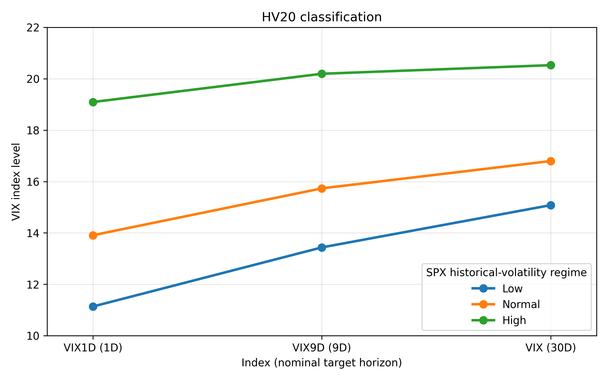
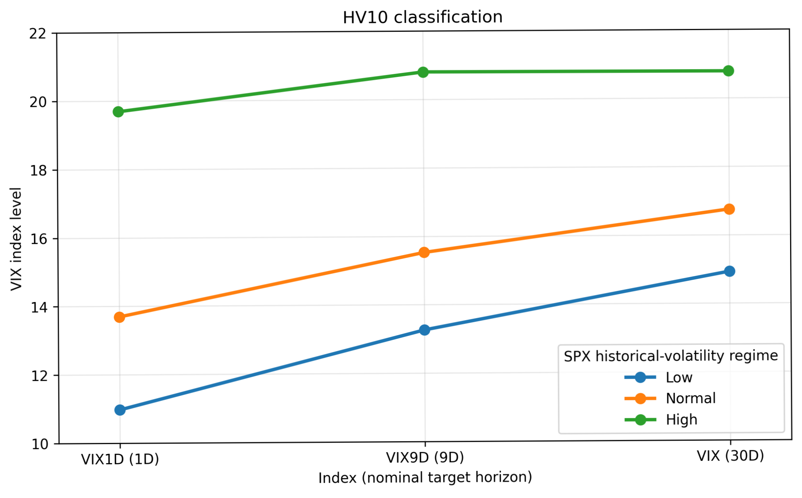
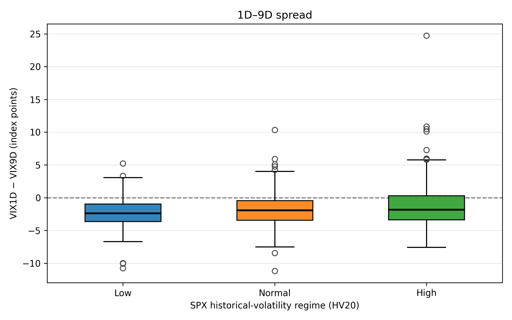
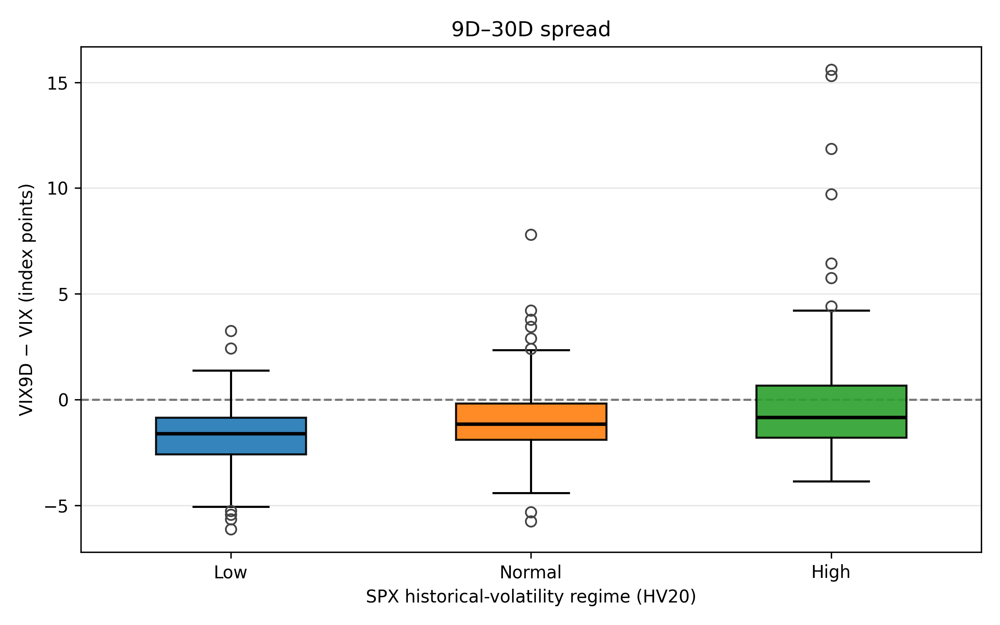
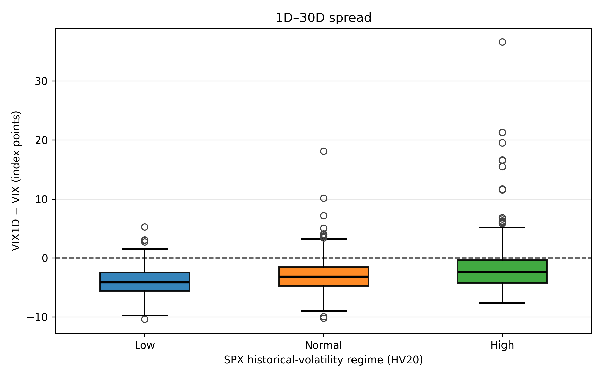
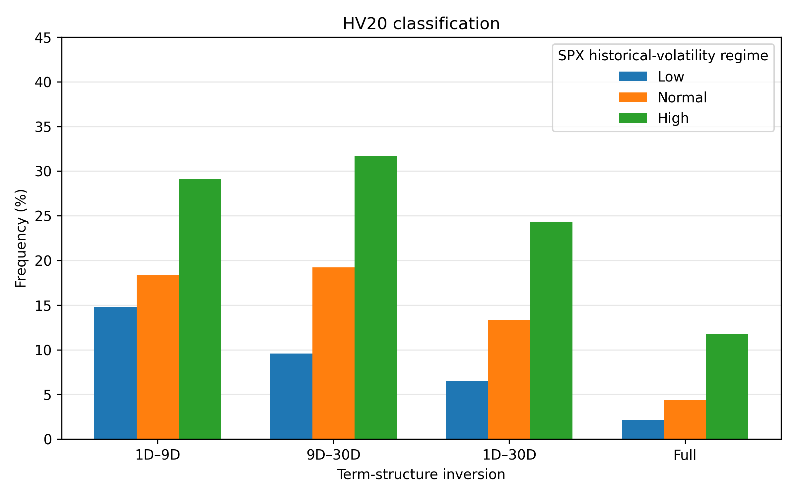
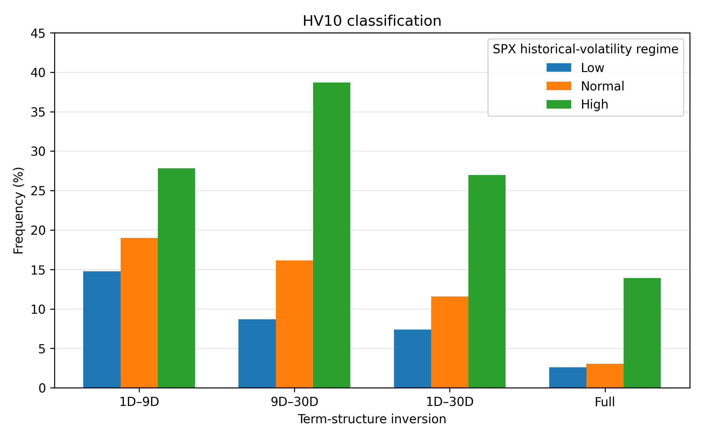
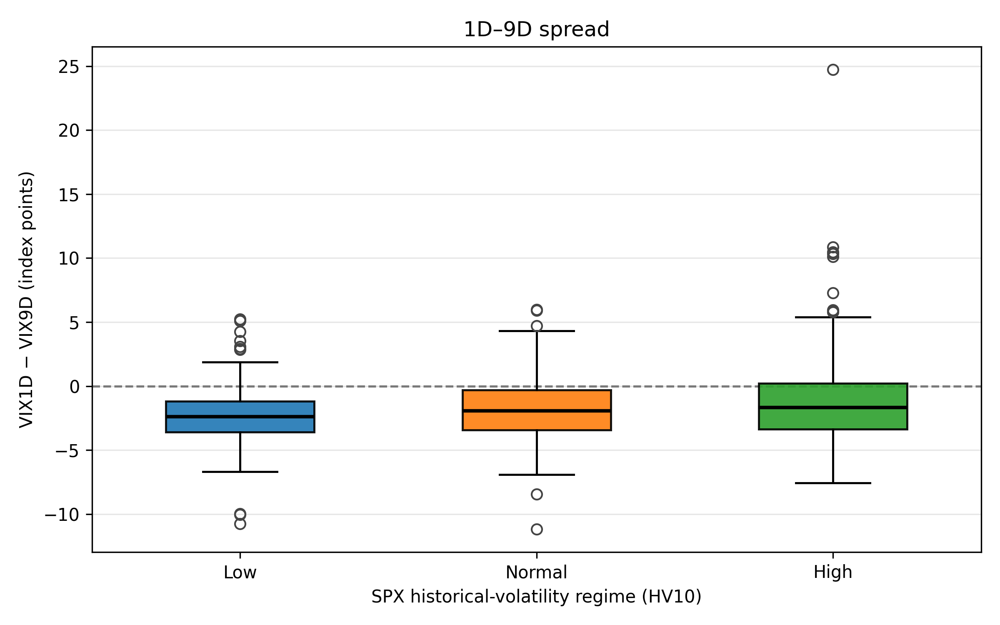
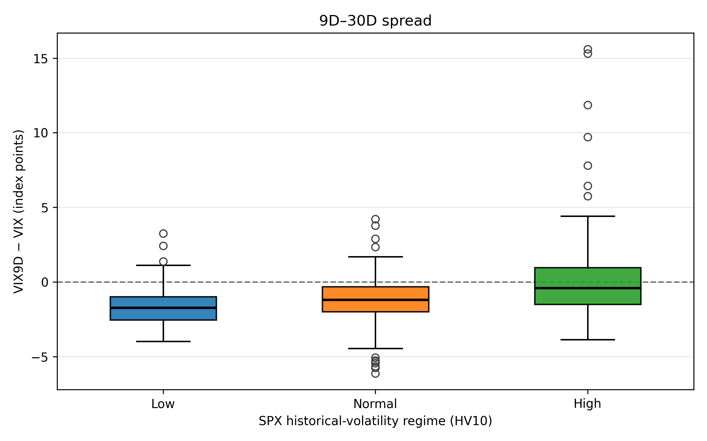
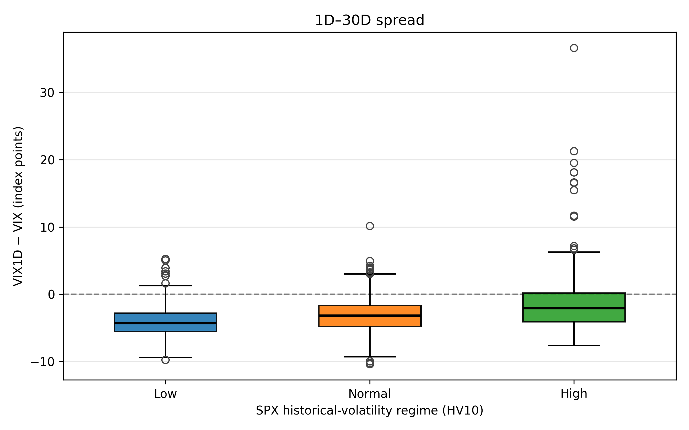

# Abstract

This study examines how the short-end VIX1D–VIX9D–VIX implied-volatility term structure varies across Low, Normal, and High regimes of S&P 500 (SPX) historical volatility. Using 918 daily trading sessions, regimes are defined from rolling 20-session SPX historical volatility (HV20), with a 10-session specification (HV10) used to assess sensitivity. A descriptive comparison evaluates median pairwise spreads, spread dispersion, and pairwise and full inversion frequencies. Under both classifications, higher historical-volatility regimes exhibit higher implied-volatility index levels and less negative median spreads, indicating a flatter term structure. Median spreads nevertheless remain negative for all segments and regimes, so the central pairwise configurations remain upward sloping rather than inverted. The High regime also displays larger spread interquartile ranges and more frequent inversions, although inversions remain a minority of observations. All six median spread contrasts against the Normal regime retain their signs across HV20 and HV10, while several differ in magnitude. Together, these findings characterize changes in the central position, absolute dispersion, and inversion frequency of the same underlying index configurations within the sample. They are descriptive and do not establish causal mechanisms, predictive value, or generalizability beyond the period and classifications studied.

# 1. Introduction

The implied-volatility term structure describes how volatility expectations embedded in option prices vary across different horizons [@cboeTermStructure]. The VIX measures 30-day expected volatility of the S&P 500 derived from SPX option prices, while VIX9D and VIX1D capture the corresponding nine-day and one-day horizons, respectively [@whaley2009; @cboeVIX1DMethodology; @cboeTermIndicesMethodology]. Together, these three indices characterize the short end of the implied-volatility term structure. An upward-sloping configuration indicates that longer-horizon implied volatility exceeds shorter-horizon implied volatility, while a flatter or inverted configuration reflects a narrowing or reversal of this relationship.

The distinction between the level and the shape of the term structure is central to this study. Changes in implied-volatility levels across different horizons do not necessarily occur in the same proportion, meaning that the relative configuration of the indices may change even when their levels move in the same direction. Examining term-structure shape therefore provides information beyond individual volatility-index levels. This motivates investigating how the relative configuration varies across historical-volatility environments of the underlying S&P 500.

The central research question is: " **How does the VIX1D–VIX9D–VIX implied-volatility term structure vary across Low, Normal, and High SPX historical-volatility regimes?**"

Market regimes are constructed from SPX historical volatility rather than from the implied-volatility indices themselves, keeping the classification criterion distinct from the term-structure measures being examined.

The study adopts a descriptive and comparative approach to characterize the direction and magnitude of differences in term-structure shape across these regimes. Median pairwise spreads provide the primary basis for comparison, complemented by additional descriptive measures and a sensitivity analysis using an alternative historical-volatility window. The objective is to document how the relative configuration of short- and longer-horizon implied volatility differs across the historical-volatility environments observed in the sample.

# 2. Data and Variable Construction

## 2.1 Dataset and Sample

The analysis uses daily observations from January 3, 2023 to September 29, 2026, combining the closing levels of the S&P 500 Index (SPX), VIX1D, VIX9D, and VIX. The implied-volatility indices were obtained from Cboe Global Markets [@cboeVIXHistorical; @cboeVIX1DDashboard], while SPX closing values were retrieved from the FRED database, series SP500, sourced from S&P Dow Jones Indices LLC [@fredSP500].

The series are aligned by their reported trading dates, using published daily closing values rather than synchronized intraday measurements.

VIX1D was launched by Cboe on April 24, 2023. Observations preceding this date are Cboe back-tested historical index values rather than contemporaneously disseminated observations. Cboe also revised part of the pre-launch end-of-day historical series in September 2023 [@cboeVIX1DBacktest].

The initial merged dataset contains 938 trading sessions. Daily SPX log returns are calculated as

$$
r_t=\ln\left(\frac{P_t}{P_{t-1}}\right),
$$

and used to construct rolling 10-session and 20-session historical-volatility measures, denoted HV10 and HV20. For a window of $n$ trading sessions, historical volatility is calculated as the sample standard deviation of daily SPX log returns, annualized using $\sqrt{252}$:

$$
HV_{n,t}=s(r_{t-n+1},\ldots,r_t)\sqrt{252}.
$$

Throughout this paper, *historical volatility* refers to this close-to-close rolling measure estimated from daily SPX returns, rather than a high-frequency realized-volatility estimator.

Because the HV20 calculation requires 20 daily returns, the first 20 observations of the merged dataset do not have an available HV20 estimate and are excluded. The resulting analytical sample contains 918 trading sessions. Both the HV20 baseline classification and the HV10 alternative specification use this common sample, ensuring direct comparability between the two classifications in terms of sample composition.

## 2.2 Historical-Volatility Regimes

SPX historical volatility is used to classify market conditions into Low, Normal, and High regimes. HV20 serves as the baseline measure, representing volatility over approximately one trading month, while HV10 provides a shorter-window alternative for evaluating sensitivity to the regime-definition horizon.

Regime thresholds are determined separately for HV20 and HV10 using the 25th and 75th percentiles of their respective distributions over the final 918-session sample. Under HV20, these thresholds are approximately 10.16% and 14.58%, compared with 9.42% and 14.95% under HV10.

Observations below P25 are classified as Low, those from P25 through P75 inclusive as Normal, and those above P75 as High. Each classification contains 230 Low, 458 Normal, and 230 High observations.

These regimes are defined relative to the historical-volatility distribution observed within the sample. Consequently, the Normal regime represents the central portion of that distribution rather than an externally established level of normal market volatility. Because percentile thresholds are estimated using the full analytical sample, the resulting classifications are retrospective and sample-specific.

HV20 is selected as the baseline to represent a longer rolling volatility window, reducing sensitivity to recent daily fluctuations relative to HV10. This distinction is reflected in the observed regime persistence: HV20 records 75 regime changes across 917 consecutive-session transitions (8.18%), compared with 114 changes (12.43%) under HV10. The corresponding average regime lengths are approximately 12.1 and 8.0 sessions, respectively. HV10 therefore provides a shorter-window, more frequently changing alternative for assessing the sensitivity of the descriptive findings to the historical-volatility window used to define regimes.

::: {#tbl-regimes}
| Regime classification | P25 threshold | P75 threshold | Low | Normal | High | Total |
|-----------|----------:|----------:|----------:|----------:|----------:|----------:|
| HV20                  |        10.16% |        14.58% | 230 |    458 |  230 |   918 |
| HV10                  |         9.42% |        14.95% | 230 |    458 |  230 |   918 |

Regime thresholds and sample composition.
:::

## 2.3 Term-Structure Measures

\Needspace{7\baselineskip}

The primary measures of relative term-structure shape are three pairwise spreads, expressed in volatility-index points:

- **1D–9D spread:** VIX1D − VIX9D
- **9D–30D spread:** VIX9D − VIX
- **1D–30D spread:** VIX1D − VIX

A negative spread indicates that longer-horizon implied volatility exceeds shorter-horizon implied volatility, while a positive spread indicates the opposite configuration.

The three spreads are algebraically related:

$$
(VIX1D-VIX)=(VIX1D-VIX9D)+(VIX9D-VIX).
$$

Thus, the 1D–30D spread captures the overall difference between the shortest and longest horizons but does not represent an independent dimension of term-structure shape. The three spreads are retained to describe both adjacent segments and the full short-end configuration.

\Needspace{7\baselineskip}

Three ratios are also calculated:

- VIX1D / VIX9D
- VIX9D / VIX
- VIX1D / VIX

A ratio equal to 1 indicates equal index levels at the two horizons being compared. Values below 1 indicate an upward-sloping configuration, while values above 1 indicate inversion. The distance from 1 provides a scale-relative representation of the difference between the corresponding volatility-index levels, complementing the absolute differences measured by spreads.

\Needspace{7\baselineskip}

For descriptive purposes, pairwise differences are additionally expressed as horizon-normalized slopes based on the nominal target horizons:

- **1D–9D slope:** (VIX9D − VIX1D) / 8
- **9D–30D slope:** (VIX − VIX9D) / 21
- **1D–30D slope:** (VIX − VIX1D) / 29

These slopes use the opposite sign convention from the spreads: positive values indicate an upward segment, while negative values indicate inversion. Each slope is a deterministic transformation of its corresponding spread, obtained by reversing its sign and dividing by a fixed nominal horizon difference. Slopes therefore do not provide independent information about term-structure shape.

The normalization is based on nominal horizon differences rather than uniformly defined effective-time intervals. VIX1D uses business-time conventions, whereas VIX9D and VIX employ calendar-time conventions in their respective calculations [@cboeVIX1DMethodology; @cboeTermIndicesMethodology]. Accordingly, the slopes are used as descriptive normalizations of published index-level differences.

\Needspace{7\baselineskip}

Finally, inversion indicators are constructed for each pairwise segment. A pairwise inversion occurs when the shorter-horizon volatility index exceeds the longer-horizon index. A full inversion requires the simultaneous ordering

$$
VIX1D > VIX9D > VIX.
$$

The corresponding inversion frequencies describe the proportion of trading sessions in which each configuration occurs.

\clearpage

# 3. Methodology

The empirical analysis examines the distribution of term-structure measures across the historical-volatility regimes defined in Section 2. For each regime, the three pairwise spreads are summarized using their mean, median, 25th and 75th percentiles, and interquartile range (IQR). The median is prioritized as the primary measure of central tendency because it is less sensitive to extreme observations than the mean, while quartiles and IQR characterize distributional position and dispersion.

The analysis also reports regime-specific medians of the daily ratios, horizon-normalized slopes, and inversion frequencies defined in Section 2.3. These measures complement the absolute spread comparisons by describing scale-relative differences, normalized segment configurations, and the frequency of inverted term structures.

To characterize differences between regimes, median spreads are compared using Normal as the reference category. For each spread (S_j), the descriptive contrast is defined as

$$
\Delta_{j,r}
=
\operatorname{median}(S_j\mid R=r)
-
\operatorname{median}(S_j\mid R=\mathrm{Normal}),
\qquad
r\in\{\mathrm{Low},\mathrm{High}\}.
$$

Here, (R) denotes the historical-volatility regime classification. The contrasts represent Low − Normal and High − Normal differences in the observed sample medians for each of the three spreads. Their signs indicate the direction of the differences, while their magnitudes quantify the corresponding changes in volatility-index points. Because medians are not generally additive, the median contrast for the 1D–30D spread need not equal the sum of the corresponding contrasts for the two adjacent spreads.

The HV20 classification serves as the baseline for these comparisons. To assess sensitivity to the historical-volatility window, the same descriptive procedures are repeated under the HV10 classification using the identical 918-session sample. The two specifications are compared in terms of the direction and magnitude of median spread differences and the broader descriptive patterns observed across the term-structure measures.

The methodology is descriptive throughout: regime comparisons are based on observed sample statistics, without formal hypothesis testing or confidence-interval estimation.

# 4. Results

## 4.1 Term-Structure Levels and Shape

Across higher SPX historical-volatility regimes, the short-end implied-volatility term structure exhibits higher average index levels and a progressively flatter configuration under both HV20 and HV10 classifications. The increase in implied volatility is not uniform across horizons, with larger changes observed at the shorter end. Under the baseline HV20 classification, average VIX1D, VIX9D, and VIX levels rise from 11.14, 13.44, and 15.08 in the Low regime to 19.10, 20.20, and 20.53 in the High regime, respectively. These correspond to increases of 7.96, 6.76, and 5.45 volatility-index points. Consequently, the average 1D–30D spread becomes less negative, moving from −3.94 to −1.43. The same pattern is observed in the median 1D–30D spread, which increases from −4.125 to −2.420. Both adjacent segments also exhibit less negative average and median spreads across higher regimes. The HV10 classification produces a similar directional pattern. Average and median spreads become less negative from Low to High, while median ratios move closer to one. Horizon-normalized slopes change consistently with the corresponding spreads, as shown in Appendix B.

::: {#fig-term-structure layout-ncol="1"}
{fig-align="center" width="65%"}

{fig-align="center" width="65%"}

Average VIX1D–VIX9D–VIX term structure across Low, Normal, and High SPX historical-volatility regimes.
:::

\clearpage

## 4.2 Distributional Shift and Dispersion

The changes in term-structure shape extend beyond central tendency. Under both classifications, the median spreads become less negative from Low to High, accompanied by generally upward shifts in the 25th and 75th percentiles. Nevertheless, median spreads remain negative across all three regimes and all three segments, indicating that each pairwise segment retains an upward-sloping central tendency.

Dispersion is also greatest in the High regime, which exhibits the largest interquartile range (IQR) for every spread. Under HV20, the IQR rises from 2.69 in Low to 3.67 in High for the 1D–9D spread, from 1.73 to 2.46 for 9D–30D, and from 3.09 to 3.90 for 1D–30D. The same High-regime ordering of dispersion is observed under HV10 (Appendix A).

The upper portions of the distributions also differ across regimes. Under HV20, the 75th percentile becomes positive in the High regime for the 1D–9D and 9D–30D spreads, while under HV10 it is positive for all three segments. The largest positive spread observations under HV20 likewise occur in the High regime, reaching approximately 25, 16, and 37 index points for the 1D–9D, 9D–30D, and 1D–30D spreads, respectively.

::: {#fig-spread-boxplots layout-ncol="2"}
{width="85%"}

{width="85%"}

{width="85%"}

Distribution of VIX short-end term-structure spreads across Low, Normal, and High HV20 historical-volatility regimes.
:::

\clearpage

## 4.3 Inversion Frequencies

Pairwise and full term-structure inversions become progressively more frequent from Low to Normal to High under both historical-volatility classifications (@fig-inversion-frequency).

Under HV20, the 1D–9D inversion frequency rises from 14.78% in the Low regime to 29.13% in the High regime, while the 9D–30D frequency increases from 9.57% to 31.74%. The corresponding 1D–30D frequency increases from 6.52% to 24.35%. Full inversions, requiring VIX1D \> VIX9D \> VIX, rise from 2.17% to 11.74%.

Under HV10, the increasing pattern is preserved. In the High regime, inversion frequencies reach 27.83% for 1D–9D, 38.70% for 9D–30D, and 26.96% for 1D–30D, while full inversions occur in 13.91% of observations.

The 9D–30D segment records the highest High-regime inversion frequency under both classifications. However, no pairwise or full inversion frequency exceeds 50% in any regime. Thus, despite becoming more frequent at higher historical-volatility levels, inversions remain a minority of observations within each regime.

::: {#fig-inversion-frequency layout-ncol="2"}
{fig-align="center"}

{fig-align="center"}

Frequency of pairwise and full VIX term-structure inversions across Low, Normal, and High SPX historical-volatility regimes.
:::

\clearpage

## 4.4 Sensitivity to HV20 and HV10 Classification

The comparison between HV20 and HV10 indicates that the direction of the observed median spread differences is preserved across the two regime classifications, although their magnitudes vary.

Using Normal as the reference regime, all six median spread contrasts retain the same sign under both specifications: Low − Normal differences are negative, while High − Normal differences are positive. This ordering is observed for the two adjacent segments and the overall 1D–30D spread.

::: {#tbl-median-contrasts}
| Spread | Comparison    | HV20 median difference | HV10 median difference |
|:-------|:--------------|-----------------------:|-----------------------:|
| 1D–9D  | Low − Normal  |                 −0.435 |                 −0.450 |
| 1D–9D  | High − Normal |                 +0.125 |                 +0.280 |
| 9D–30D | Low − Normal  |                 −0.455 |                 −0.545 |
| 9D–30D | High − Normal |                 +0.300 |                 +0.785 |
| 1D–30D | Low − Normal  |                 −0.970 |                 −1.100 |
| 1D–30D | High − Normal |                 +0.735 |                 +1.090 |

: Observed differences in median term-structure spreads relative to the Normal regime under HV20 and HV10. Values are expressed in volatility-index points.
:::

Although the signs are consistent, some contrasts change appreciably in magnitude. The largest difference between classifications occurs in the 9D–30D High − Normal contrast, which increases from +0.300 under HV20 to +0.785 under HV10. The 1D–30D High − Normal contrast likewise rises from +0.735 to +1.090, whereas the 1D–9D Low − Normal contrast remains similar at −0.435 and −0.450.

Overall, the HV10 classification preserves the directional ordering of median spread differences observed under HV20, while producing different magnitudes for several comparisons. The broader descriptive patterns of higher implied-volatility levels, flatter term structures, greater High-regime spread dispersion, and increasing inversion frequencies are also observed under both classifications.

# 5. Discussion

## 5.1 Economic Interpretation of Term-Structure Flattening

The principal finding is that higher SPX historical-volatility regimes are associated with a flatter short-end implied-volatility term structure. Economically, this reflects a change in the relative levels of implied volatility across horizons, rather than simply an increase in overall implied volatility. Under both classifications, implied-volatility levels rise from Low to High, but the increases are not uniform: VIX1D rises more than VIX, narrowing the gap between the shortest and longest horizons. In economic terms, this indicates that shorter-horizon implied volatility becomes relatively more elevated compared with longer-horizon implied volatility in higher historical-volatility regimes. The resulting flattening reflects a change in the relative pricing of volatility across horizons, without identifying the underlying contributions of volatility expectations or risk premia.

This distinction explains why higher implied-volatility levels and a flatter term structure can coexist. Flattening does not require implied volatility to decline; it occurs when shorter-horizon implied volatility increases relative to longer-horizon implied volatility. In the observed sample, this adjustment reduces the upward slope of the term structure without generally reversing its configuration. Median pairwise spreads remain negative across all regimes, indicating that the central value of each segment retains an upward-sloping relationship even in the High regime.

The distinction between mean and median configurations further qualifies this result. Under HV10, the average 9D–30D spread in the High regime is approximately zero, whereas its median remains negative. The near-flat average therefore does not represent the median configuration. This difference is consistent with positive spread observations exerting greater influence on the mean, without establishing how many observations account for the divergence. Consequently, average index levels and median spreads provide complementary perspectives on term-structure shape, with the latter better representing the central configuration of the observed spread distributions.

## 5.2 Distributional Heterogeneity and Inversions

The association between historical-volatility regimes and term-structure shape extends beyond changes in central tendency. In the High regime, spread distributions exhibit larger interquartile ranges alongside less negative median values and more frequent inversions. These characteristics describe different dimensions of the same distributional pattern.

As median spreads become less negative, the gap between shorter- and longer-horizon implied volatility narrows, indicating a flatter central term-structure configuration, while a larger interquartile range indicates greater dispersion in the observed spread values. More frequent inversions, in turn, show that a larger proportion of sessions feature shorter-horizon implied volatility above longer-horizon implied volatility. These observations are compatible: a distribution can shift toward less negative values and contain more inversions while retaining a negative median.

The High regime is therefore characterized not only by a flatter central configuration but also by a greater dispersion within the central 50% of the observed spread distributions. Upward-sloping segments remain prevalent, even as inverted configurations become more common. The fact that inversion frequencies remain below 50% reinforces the distinction between an increased occurrence of inversions and a predominantly inverted term structure.

Taken together, these findings indicate that changes in term-structure shape across historical-volatility regimes involve both the relative position of implied-volatility horizons and the distribution of their differences. Median spreads capture the central relationship, dispersion measures describe its variability, and inversion frequencies identify how often that relationship reverses.

## 5.3 Interpretation of HV20–HV10 Sensitivity

The comparison between HV20 and HV10 provides a way to assess how the descriptive characterization depends on the historical-volatility window used to classify market conditions. The preservation of all six median spread contrast signs indicates that the directional ordering observed under HV20 is also present when regimes are defined using HV10.

This consistency extends to the broader descriptive patterns: higher historical-volatility regimes are associated with higher implied-volatility levels, flatter term structures, greater High-regime spread dispersion, and more frequent inversions under both classifications. The principal observations are therefore not exclusive to the baseline HV20 definition.

However, directional consistency does not imply that the magnitude of the relationships is unchanged. Several median spread contrasts differ appreciably between the classifications, particularly the High − Normal comparison for the 9D–30D segment. Because HV10 and HV20 use different rolling windows and percentile thresholds, the same trading sessions may be assigned to different regimes. The resulting differences in regime composition affect the descriptive statistics calculated within each classification.

The HV20–HV10 comparison thus supports a distinction between the qualitative consistency of the observed patterns and the sensitivity of their quantitative magnitudes. Both classifications describe a similar direction of variation in short-end term-structure shape, but the extent of that variation depends partly on how the historical-volatility environments are defined.

# 6. Limitations

## 6.1 Sample and Data Coverage

The analysis covers 918 trading sessions from February 1, 2023 to September 29, 2026. This period provides a limited historical perspective, and the observed relationships may not characterize term-structure behavior across longer or substantially different market environments.

The use of daily closing observations does not capture intraday changes in implied-volatility configurations. Furthermore, the series are aligned by trading date rather than synchronized intraday timestamps, so the comparisons do not necessarily represent index levels observed at precisely the same moment. The sample also includes VIX1D observations preceding its official launch on April 24, 2023, which are based on Cboe back-tested historical index values rather than contemporaneously disseminated observations.

The analysis is restricted to three implied-volatility indices targeting approximately one-day, nine-day, and 30-day horizons. Consequently, the findings characterize only the short end of the spot implied-volatility term structure and cannot be extended directly to the full maturity structure, the broader option-implied volatility surface, or VIX futures dynamics, including contango, backwardation, and roll yield.

## 6.2 Regime Classification and Generalizability

The percentile-based regime classification identifies relative volatility conditions within the observed sample rather than universal market states. Consequently, the High regime does not necessarily represent periods of acute market stress, and the empirical patterns associated with each regime may differ under alternative samples or historical periods.

Because the thresholds are estimated using the full analytical sample, regime assignments are retrospective and cannot be interpreted as classifications that would have been available in real time. The observed relationships therefore do not establish the usefulness of this framework for prospective regime identification or prediction.

The sensitivity assessment is also restricted to two historical-volatility windows, HV20 and HV10. Although the principal descriptive patterns remain directionally consistent across these classifications, their magnitudes vary. The analysis does not establish whether similar relationships would persist under other volatility windows, percentile thresholds, or regime-classification methods.

## 6.3 Descriptive Scope and Measurement Limitations

The study is descriptive and does not employ formal hypothesis tests or confidence-interval estimation. Accordingly, differences in median spreads, dispersion, and inversion frequencies characterize the observed sample without quantifying their statistical uncertainty. The directional ordering across regimes should therefore not be interpreted as statistical evidence of a generalizable or monotonic relationship.

Daily observations may also exhibit serial dependence and clustering within volatility episodes, meaning that consecutive sessions do not necessarily provide independent information. The descriptive comparisons do not adjust for this dependence or establish how much the observed patterns depend on particular volatility episodes.

Dispersion is evaluated using interquartile ranges of spreads expressed in volatility-index points. Since implied-volatility levels also increase across regimes, larger IQRs in the High regime do not necessarily imply greater dispersion relative to the prevailing level of implied volatility. No scale-normalized dispersion measure is examined. Similarly, the extreme positive spread observations are retained in the analysis but are not investigated separately, leaving their contribution to the observed distributional patterns unquantified.

Finally, the term-structure measures provide related rather than independent representations of the same index configurations. In particular, the algebraic relationship among the spreads and the deterministic construction of horizon-normalized slopes mean that consistency across these measures should not be interpreted as independent confirmation of the observed patterns. Ratios and inversion indicators are likewise derived from the same underlying volatility-index levels and describe complementary aspects of their relative configuration rather than independent empirical evidence.

## 6.4 Causal Interpretation

The observational design does not establish whether SPX historical volatility directly influences implied-volatility term-structure configurations or whether both respond to common market conditions. The observed associations therefore cannot be interpreted as evidence of a causal relationship between historical volatility and term-structure shape.

# 7. Conclusion

This study examined how the VIX1D–VIX9D–VIX implied-volatility term structure varies across Low, Normal, and High SPX historical-volatility regimes over a sample of 918 trading sessions. Under both HV20 and HV10 classifications, higher historical-volatility regimes are associated with higher implied-volatility levels and less negative median pairwise spreads, indicating a progressively flatter short-end term structure. However, median spreads remain negative across all regimes and segments, indicating that each pairwise segment retains an upward-sloping central tendency rather than an inverted one.

Beyond changes in central tendency, the analysis documents larger interquartile ranges of spreads in the High regime and more frequent pairwise and full inversions. These findings jointly characterize changes in the position, dispersion, and inversion frequencies of the observed term-structure distributions. They provide complementary descriptions of the same underlying volatility-index configurations rather than statistically independent evidence.

The comparison between HV20 and HV10 shows that the direction of all six median spread contrasts relative to the Normal regime is preserved across classifications, together with the principal descriptive patterns. Nevertheless, several contrasts differ in magnitude, indicating that the quantitative characterization of term-structure differences is sensitive to the historical-volatility window used to define regimes.

Overall, the study documents a descriptive association between SPX historical-volatility regimes and the relative configuration of short- and longer-horizon implied volatility within the observed sample. These findings do not establish causal mechanisms, predictive relationships, or general validity beyond the period and regime definitions examined.

\clearpage

# References

::: {#refs}
:::

\clearpage

# Appendix

## Appendix A — HV10 Spread Distributions

::: {#fig-appendix-hv10-boxplots layout-ncol="2"}
{width="90%"}

{width="90%"}

{width="90%"}

Distribution of VIX short-end term-structure spreads across Low, Normal, and High HV10 regimes.
:::

\clearpage

## Appendix B — Additional Descriptive Statistics

::: {#tbl-appendix-stats}
### B.1 Spread Distribution Statistics

| Classification | Spread | Regime |   Mean | Median |    P25 |    P75 |   IQR |
|----------------|--------|--------|-------:|-------:|-------:|-------:|------:|
| HV20           | 1D–9D  | Low    | −2.294 | −2.375 | −3.630 | −0.940 | 2.690 |
| HV20           | 1D–9D  | Normal | −1.825 | −1.940 | −3.438 | −0.440 | 2.998 |
| HV20           | 1D–9D  | High   | −1.103 | −1.815 | −3.358 | +0.310 | 3.668 |
| HV20           | 9D–30D | Low    | −1.645 | −1.610 | −2.580 | −0.850 | 1.730 |
| HV20           | 9D–30D | Normal | −1.057 | −1.155 | −1.900 | −0.180 | 1.720 |
| HV20           | 9D–30D | High   | −0.324 | −0.855 | −1.788 | +0.670 | 2.458 |
| HV20           | 1D–30D | Low    | −3.938 | −4.125 | −5.540 | −2.450 | 3.090 |
| HV20           | 1D–30D | Normal | −2.882 | −3.155 | −4.720 | −1.505 | 3.215 |
| HV20           | 1D–30D | High   | −1.426 | −2.420 | −4.228 | −0.328 | 3.900 |
| HV10           | 1D–9D  | Low    | −2.285 | −2.390 | −3.598 | −1.188 | 2.410 |
| HV10           | 1D–9D  | Normal | −1.828 | −1.940 | −3.438 | −0.298 | 3.140 |
| HV10           | 1D–9D  | High   | −1.105 | −1.660 | −3.375 | +0.208 | 3.583 |
| HV10           | 9D–30D | Low    | −1.666 | −1.745 | −2.540 | −0.988 | 1.553 |
| HV10           | 9D–30D | Normal | −1.219 | −1.200 | −1.998 | −0.313 | 1.685 |
| HV10           | 9D–30D | High   | +0.021 | −0.415 | −1.505 | +0.968 | 2.473 |
| HV10           | 1D–30D | Low    | −3.951 | −4.265 | −5.505 | −2.775 | 2.730 |
| HV10           | 1D–30D | Normal | −3.047 | −3.165 | −4.758 | −1.633 | 3.125 |
| HV10           | 1D–30D | High   | −1.085 | −2.075 | −4.088 | +0.180 | 4.268 |

: Descriptive statistics for term-structure spreads across HV20 and HV10 historical-volatility regimes.
:::

\clearpage

### B.2 Median Ratios and Slopes

::: {#tbl-appendix-ratios-slopes}
| Classification | Measure       |   Low | Normal |  High |
|----------------|---------------|------:|-------:|------:|
| HV20           | VIX1D / VIX9D | 0.813 |  0.865 | 0.918 |
| HV20           | VIX9D / VIX   | 0.887 |  0.928 | 0.958 |
| HV20           | VIX1D / VIX   | 0.716 |  0.802 | 0.876 |
| HV20           | 1D–9D slope   | 0.297 |  0.243 | 0.227 |
| HV20           | 9D–30D slope  | 0.077 |  0.055 | 0.041 |
| HV20           | 1D–30D slope  | 0.142 |  0.109 | 0.083 |
| HV10           | VIX1D / VIX9D | 0.813 |  0.866 | 0.918 |
| HV10           | VIX9D / VIX   | 0.882 |  0.926 | 0.976 |
| HV10           | VIX1D / VIX   | 0.714 |  0.804 | 0.890 |
| HV10           | 1D–9D slope   | 0.299 |  0.243 | 0.208 |
| HV10           | 9D–30D slope  | 0.083 |  0.057 | 0.020 |
| HV10           | 1D–30D slope  | 0.147 |  0.109 | 0.072 |

: Median term-structure ratios and slopes across historical-volatility regimes.
:::